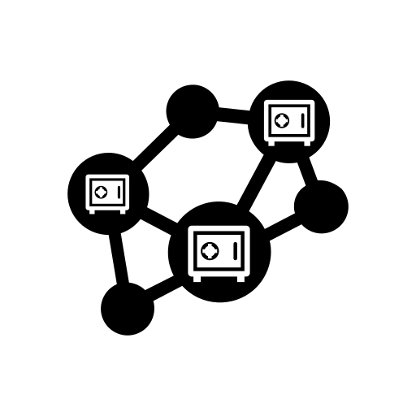
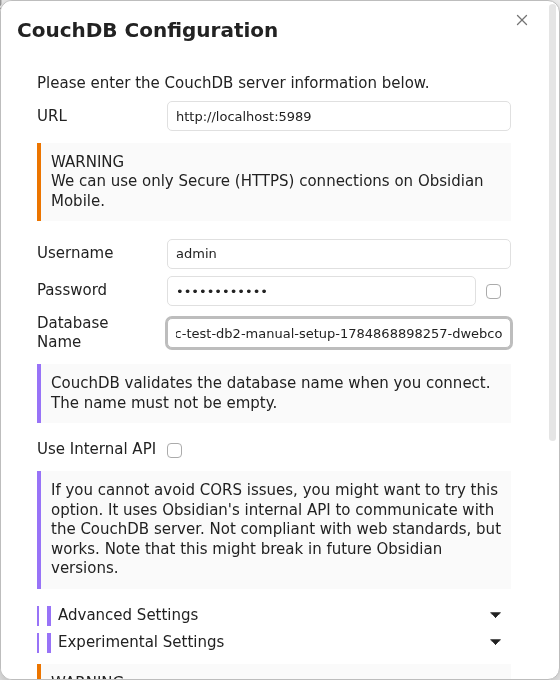
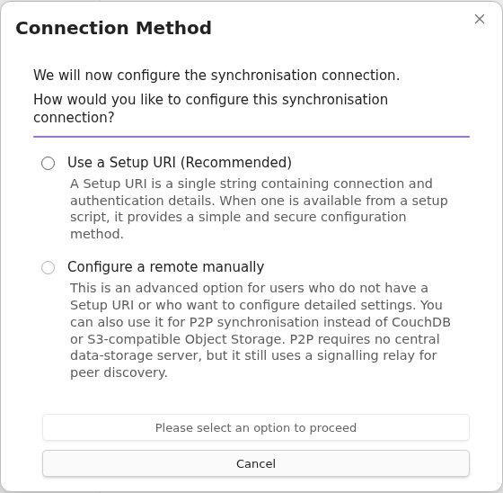

<h1>
  
  Obsidian LiveSync, packagé pour YunoHost
</h1>

Serveur de synchronisation pour l'extension Obsidian LiveSync

## Captures d'écran

## 📦 Informations développeur

🛠️ Dépôt en amont de Obsidian LiveSync : <https://github.com/vrtmrz/obsidian-livesync>

### 📚 Documentation de packaging

Voir <https://doc.yunohost.org/dev/packaging/>.
